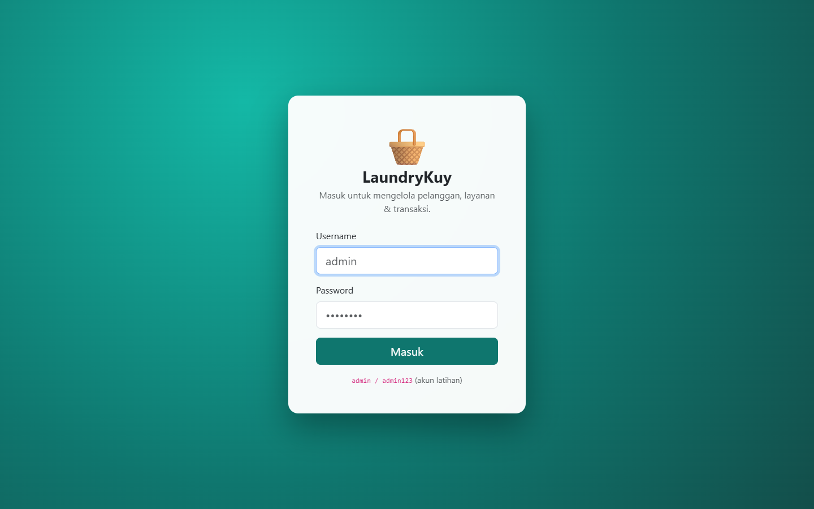
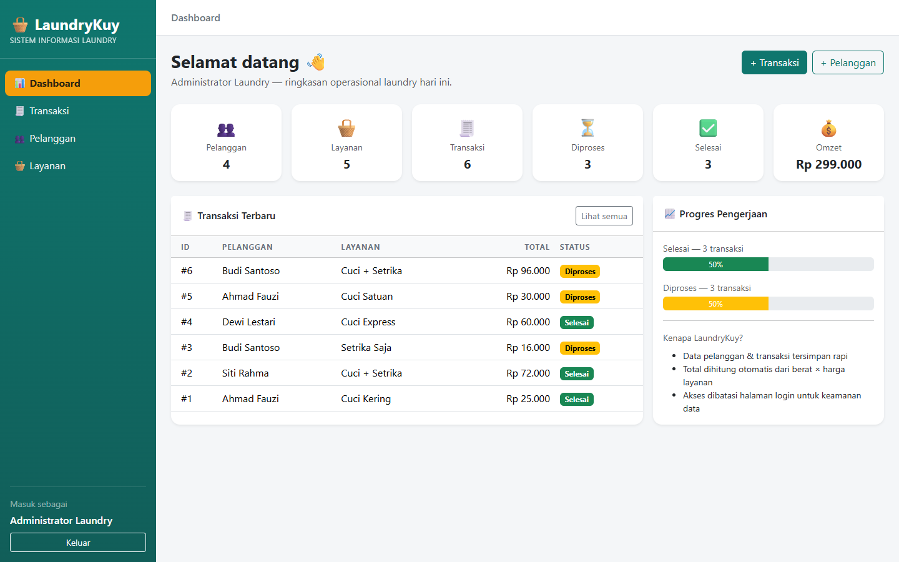
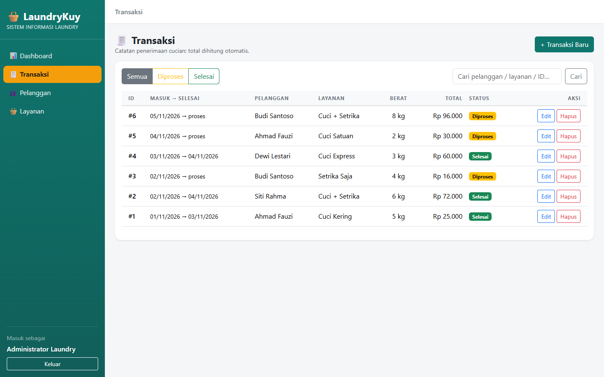
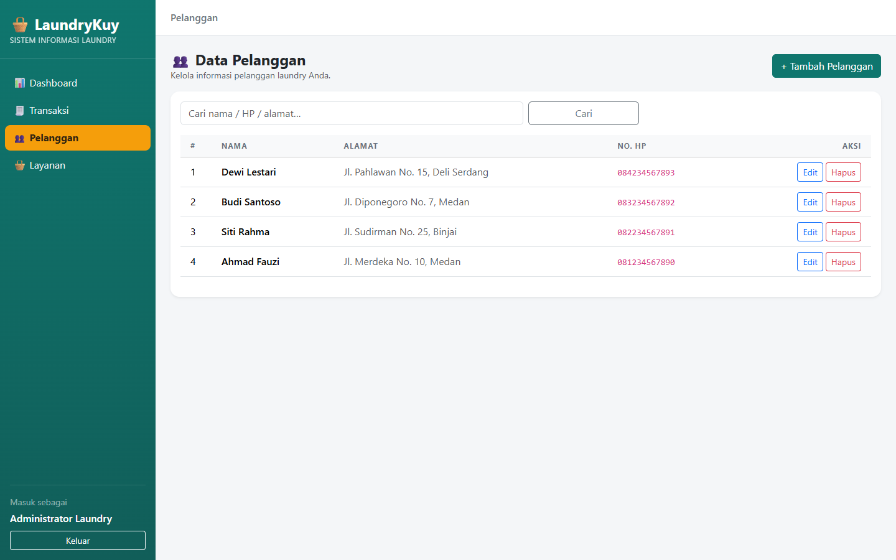
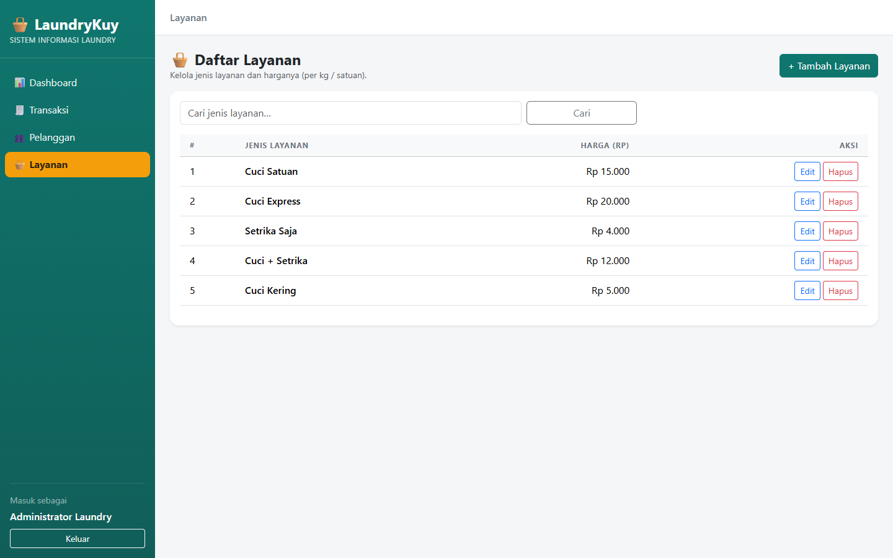
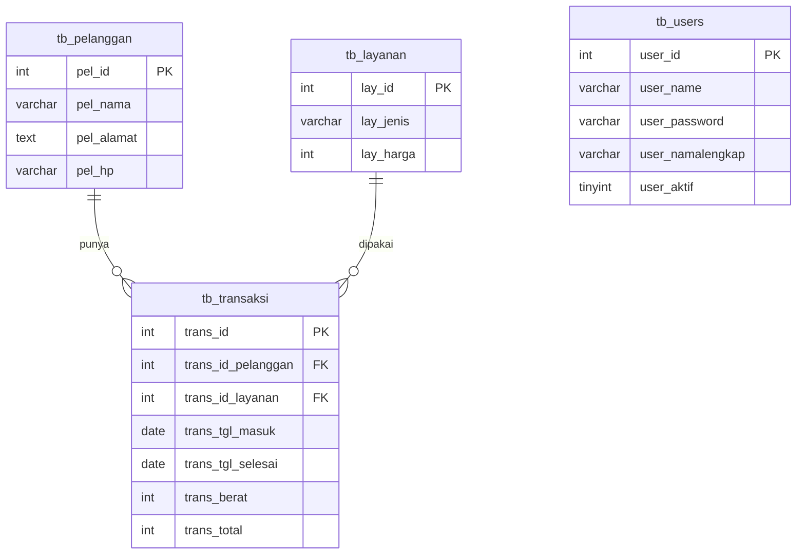

<div align="center">

# 🧺 LaundryKuy — Sistem Informasi Laundry

**Quiz · Pemrograman Berbasis Web Lanjutan**

Sistem informasi sederhana untuk pengelolaan **laundry**: **Pelanggan**, **Layanan**, **Transaksi** —
dibangun dengan **Laravel 13**, database **MySQL**, dan dilindungi **login**.


</div>

---

## 📖 Deskripsi

Menjawab soal **Quiz PBWL (2026)**:

| Soal | Jawaban |
| --- | --- |
| Rancang database MySQL (dgn query lengkap) dan eksekusi ke phpMyAdmin | File `database.sql` — membuat database + 4 tabel + data contoh |
| Sistem informasi sederhana **Laravel 13**: tampil, tambah, ubah, hapus + login | Project ini (rincian di bawah) |

> Satu desain basis data yang sama dipakai untuk versi Quiz (Laravel) dan versi Tugas (PHP MVC).

## ✨ Fitur

- 🔐 **Login** dengan password **bcrypt** (`admin` / `admin123` — akun latihan)
- 🛡️ Semua halaman aplikasi dilindungi middleware `auth` (tamu otomatis diarahkan ke login)
- 📊 **Dashboard** — ringkasan: pelanggan, layanan, transaksi, diproses/selesai, dan total omzet
- 🧾 **Transaksi** CRUD — total dihitung otomatis: **berat × harga layanan**; status otomatis **Diproses/Selesai** (dari tanggal selesai)
- 👥 **Pelanggan** CRUD (nama, alamat, HP)
- 🧺 **Layanan** CRUD (jenis & harga, format Rupiah)
- 🔍 Pencarian & filter status pada daftar transaksi
- ⚠️ Menghapus pelanggan/layanan yang masih dipakai transaksi **dicegah** (pesan ramah)
- ✅ CSRF protection, validasi server-side, escaping otomatis Blade

## 🧱 Teknologi

| Lapisan | Teknologi |
| --- | --- |
| Framework | **Laravel 13** |
| Bahasa | PHP ≥ 8.3 |
| Database | MySQL / MariaDB (**port 3307** di mesin asli; lihat `.env`) |
| UI | Bootstrap 5 (aset statis di `public/css`, `public/js`) |
| ORM | Eloquent |
| Auth | Session + `password_verify()` |

## 📸 Tampilan

<table>
  <tr>
    <td width="50%"><br><sub>Halaman login</sub></td>
    <td width="50%"><br><sub>Dashboard</sub></td>
  </tr>
  <tr>
    <td width="50%"><br><sub>Transaksi</sub></td>
    <td width="50%"><br><sub>Pelanggan</sub></td>
  </tr>
  <tr>
    <td colspan="2" align="center"><br><sub>Layanan</sub></td>
  </tr>
</table>

## 🗺️ Skema Database



**Relasi:** `tb_transaksi.trans_id_pelanggan` → `tb_pelanggan.pel_id` (FK, `ON DELETE RESTRICT`),
`tb_transaksi.trans_id_layanan` → `tb_layanan.lay_id` (FK, `ON DELETE RESTRICT`).
`tb_users` berdiri sendiri (untuk login).

## 🚀 Instalasi & Menjalankan

**Prasyarat:** PHP ≥ 8.3 (ekstensi `pdo_mysql`), Composer, MySQL/MariaDB.

1. **Letakkan folder** di `C:\xampp\htdocs\pbwl-quiz`.
2. **Buat database + tabel + data contoh** — pilih salah satu:
   - **phpMyAdmin**: buka menu **Import**, pilih `database.sql`, URL berjalan di `http://127.0.0.1:3307` (sesuaikan bila port Anda 3306); atau
   - Terminal: `mysql -u root -p laundry_quiz < database.sql`
3. **Pasang dependensi**:  `composer install`
4. **Periksa `.env`** — bagian database sudah mengarah ke `laundry_quiz` (host `127.0.0.1`, port `3307`, user `root`, password kosong). Sesuaikan dengan instalasi Anda.
   - Bila port MySQL Anda **3306**, ubah `DB_PORT=3307` → `DB_PORT=3306`.
   - `APP_KEY` sudah terisi untuk latihan.
5. **Jalankan**:
   ```bash
   php artisan serve --port=8001
   ```
6. Buka **http://127.0.0.1:8001** → login dengan **`admin` / `admin123`**.

## 🔐 Kredensial

```
Username : admin
Password : admin123
```

> ⚠️ Akun latihan; untuk pemakaian nyata, ganti password & jangan commit `.env` / kredensial ke repo publik.

## 🧭 Route

| Method | URL | Akses | Keterangan |
| --- | --- | --- | --- |
| GET | `/login` | publik | Form login |
| POST | `/login` | publik | Proses login (CSRF) |
| POST | `/logout` | 🔒 | Logout |
| GET | `/dashboard` | 🔒 | Dashboard + statistik |
| GET/POST/PUT/DELETE | `/pelanggan` | 🔒 | CRUD pelanggan |
| GET/POST/PUT/DELETE | `/layanan` | 🔒 | CRUD layanan |
| GET/POST/PUT/DELETE | `/transaksi` | 🔒 | CRUD transaksi |

## 🗄️ Skema Tabel (ringkas — lihat `database.sql`)

| Tabel | Kolom |
| --- | --- |
| **tb_pelanggan** | `pel_id` (PK), `pel_nama`, `pel_alamat` (text), `pel_hp` |
| **tb_layanan** | `lay_id` (PK), `lay_jenis`, `lay_harga` |
| **tb_transaksi** | `trans_id` (PK), `trans_id_pelanggan` (FK), `trans_id_layanan` (FK), `trans_tgl_masuk` (date), `trans_tgl_selesai` (date, nullable), `trans_berat`, `trans_total` |
| **tb_users** | `user_id` (PK), `user_name` (unique), `user_password`, `user_namalengkap`, `user_aktif` |

## 📋 Query SQL (pertanyaan 1)

Seluruh query (folder `database.sql`): **CREATE DATABASE**, **CREATE TABLE** ke-4 tabel (relasi & index), dan **INSERT** data contoh — siap dijalankan di phpMyAdmin (atau via CLI MySQL).

Aturan penting yang dipakai:
- Engine `InnoDB` + `utf8mb4` (relasi / unicode)
- `tb_transaksi` pakai **FOREIGN KEY** ke `tb_pelanggan` & `tb_layanan`
- `trans_tgl_selesai` boleh `NULL` (berarti cucian **masih diproses**)
- `tb_users.user_password` pakai **bcrypt** (bukan fungsi usang)

## 📚 Struktur

```
.
├── app/Models/{TbUser, Pelanggan, Layanan, Transaksi}.php
├── app/Http/Controllers/{LoginController, DashboardController,
│                          PelangganController, LayananController, TransaksiController}.php
├── resources/views/
│   ├── auth/login.blade.php
│   ├── dashboard.blade.php
│   ├── pelanggan/{index,create,edit}.blade.php
│   ├── layanan/{index,create,edit}.blade.php
│   └── transaksi/{index,create,edit}.blade.php
├── routes/web.php
├── database.sql          ← jawaban soal 1 (domain tabel & data contoh)
├── docs/screenshots/     ← screenshot asli aplikasi
└── public/{css,js}/      ← Bootstrap statis
```

## ✅ Checklist Jawaban Quiz

- [x] Database_mySQL sesuai desain (DDL di `database.sql`, diuji langsung di MySQL **port 3307**)
- [x] Laravel 13: tampil data (index + pagination + filter)
- [x] Laravel 13: input data (create)
- [x] Laravel 13: edit data (update)
- [x] Laravel 13: hapus data (delete, dengan proteksi FK)
- [x] Halaman login (bcrypt) + seluruh halaman terlindungi

## 📄 Lisensi

[MIT License](LICENSE)

## 🙏 Kredit

Berdasarkan soal **Quiz — Pemrograman Berbasis Web Lanjutan**, S1 Sistem Informasi, UIN Sumatera Utara Medan (Dosen: Suendri, M.Kom).
